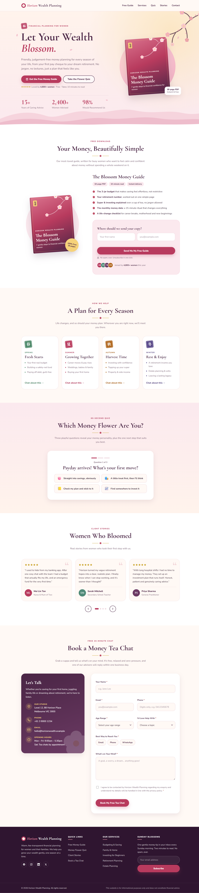

# financialplanning-trial

One-page marketing site for **Horizon Wealth Planning**, a financial planning firm. The whole site is a single `index.html` (HTML, CSS and vanilla JavaScript), deployed to GitHub Pages on every push to `main`.

## Live versions

| Version | URL | What it is |
|---|---|---|
| **v2** (current) | https://tybaltybalt-wq.github.io/financialplanning-trial/v2/ | Revamp: soft Eastern design aimed at women, with lead magnets (free guide, Money Flower quiz, guide popup) |
| v1 (original) | https://tybaltybalt-wq.github.io/financialplanning-trial/ | Original navy-and-gold site, frozen at git tag `v1` |

## Screenshots

Full-page captures of the live sites, taken with the Playwright MCP server at 1440px width.

### v2: Let Your Wealth Blossom

### v1: original

## Running locally

Open `index.html` in a browser. There is no build step.
